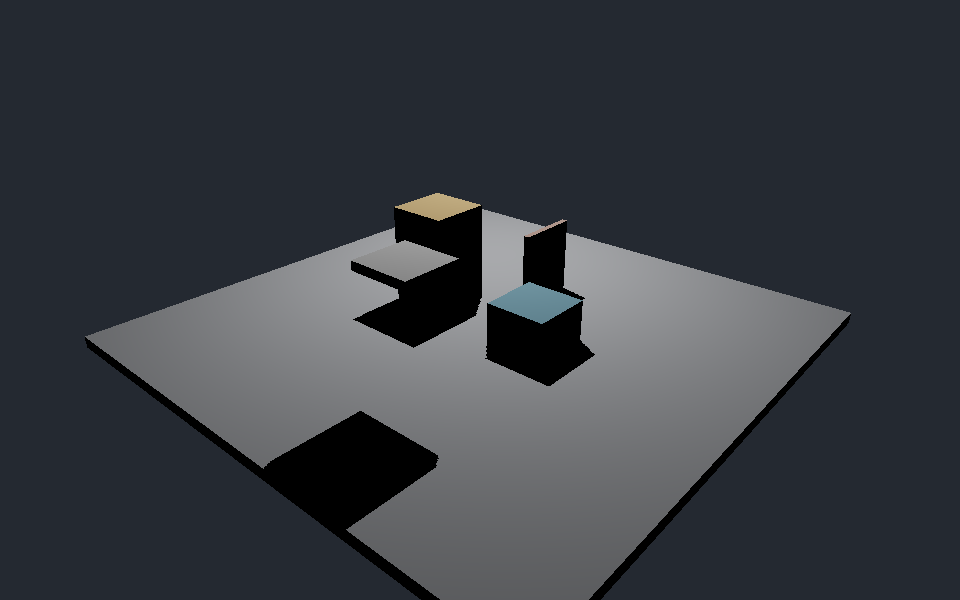
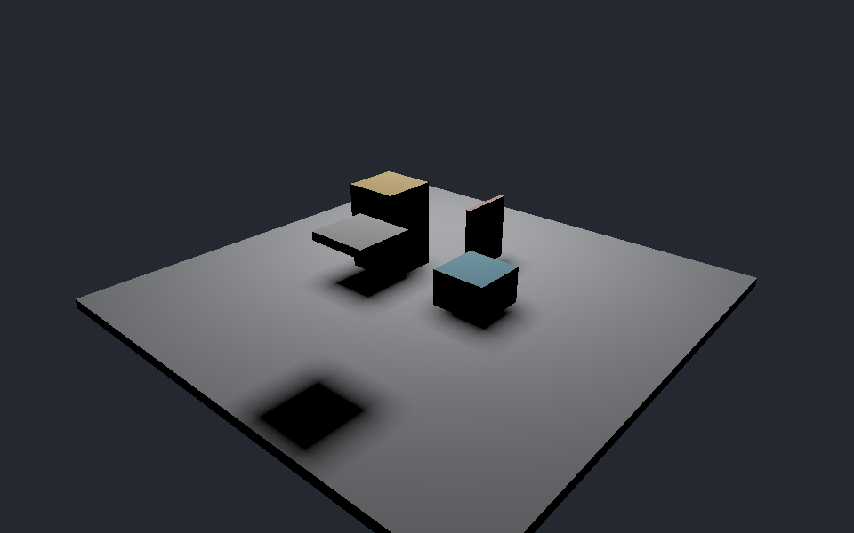
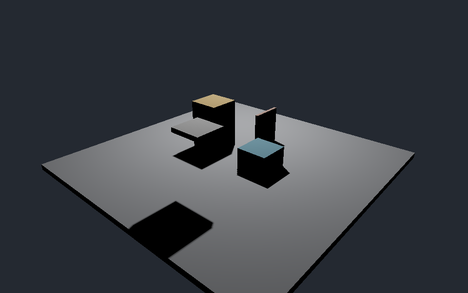
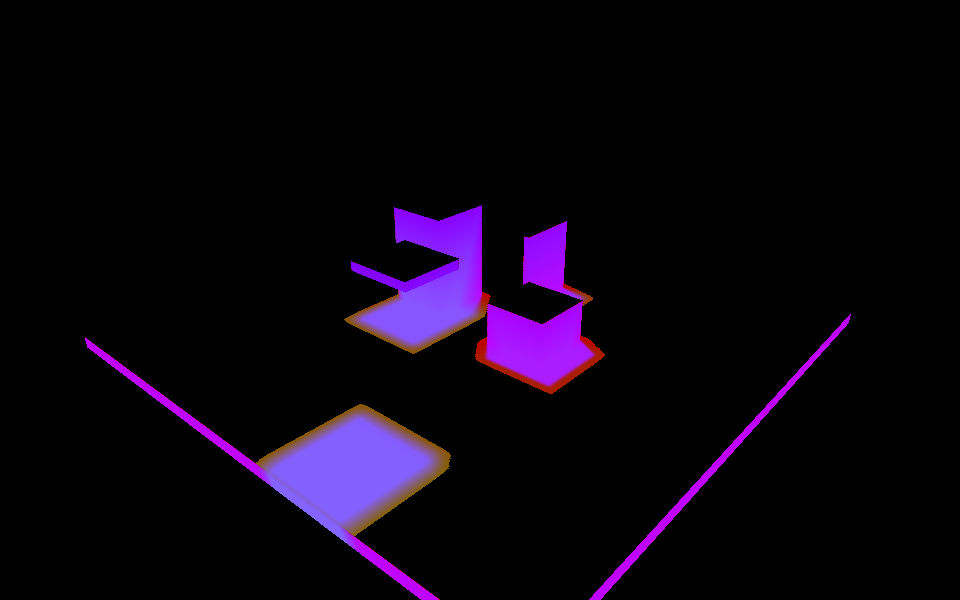
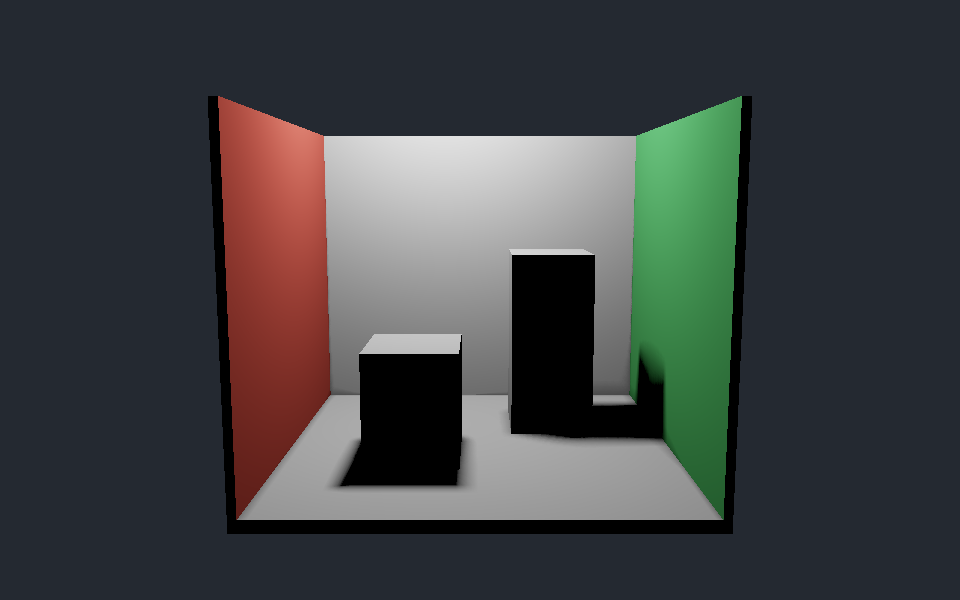
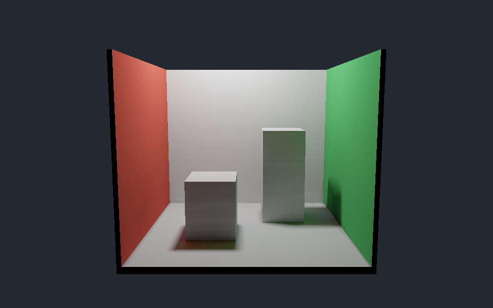

# 软阴影与光照实验

本展示围绕 Shadow Mapping、PCF、PCSS，比较阴影边缘、采样预算和参数引起的变化。独立的 `LightingShowcase` 使用原生 D3D12 compute，离屏生成图片；没有窗口或实时交互界面。


## 方法与场景

- **同一阴影测试台**：程序生成地面、不同高度的方块、薄板和悬空板。先在 GPU 以光线与 AABB 相交生成 1024² 阴影图，再由相机着色消费该图；这是固定几何教学路径，不是任意导入 mesh 的光栅阴影管线。
- **硬阴影**：比较接收深度与阴影图。PCF 对多次比较结果取平均；PCSS 进行 blocker search、半影估计和可变范围 PCF。
- **Cornell 风格小室**：开顶、红绿墙和白盒。直接光与一次 Lambert 漫反射反弹分开输出；不是 Cornell 标定数据复现，也不是完整多次反弹 GI。

直接辐照度采用光源中心点代理；`light-size` 是正方形可见性光源的完整边长，只改变阴影可见性。PCSS 使用有限样本与局部平面近似，复杂遮挡下仍可能有误差。

## 精选对照

| 硬阴影 | PCF | PCSS |
|---|---|---|
|  |  |  |

三图使用相同几何、相机、光源位置和显示变换。区别来自可见性估计。PCF 的固定模糊范围不随遮挡距离自动改变，PCSS 依据平均 blocker 深度估计半影。

| 光源边长 0.15 | 光源边长 1.2 |
|---|---|
|  |  |

改变光源尺寸观察阴影范围；它不改变本教学模型的直接光能量。参数完整值、图片尺寸和 SHA-256 见 [媒体清单](manifest.json)。

| 大 bias 反例 | 低采样预算 |
|---|---|
|  |  |

大 bias 可能让遮挡消失或阴影脱离物体；低采样预算会改变过滤误差。两者都是受控对照，不作为推荐参数。



诊断图编码：红色为平均 blocker 深度除以 8，绿色为过滤 UV 半径乘以 50，蓝色为 `1-visibility`，然后限制到 8bit。数值核验使用原始 float32 文件；图像只供定位区域。

| 直接光 | 直接光加一次反弹 |
|---|---|
|  |  |

一次反弹对首个命中表面评估直接光，再累加其漫反射贡献；不含更高阶光路。渲染保持固定采样分布以便重复比较。

## 构建与运行

Windows x64、Visual Studio 2026 C++、Windows SDK/DXC、CMake 4.2+。先确认 PATH 指向满足版本要求的 CMake。

```powershell
cmake -S samples/lighting_lab -B out/build/shadow-showcase -G "Visual Studio 18 2026" -A x64
cmake --build out/build/shadow-showcase --config Release --target LightingShowcase
out/build/shadow-showcase/Release/LightingShowcase.exe --scene shadow-bench --shadow pcss --light-size 0.65 --bias 0.004 --samples 64 --width 960 --height 600 --output out/shadow-example
out/build/shadow-showcase/Release/LightingShowcase.exe --scene cornell --indirect bounce --width 960 --height 600 --output out/cornell-example
```

每次使用新输出目录。普通运行不需要 Python、DXC 或测试框架；`--debug` 验证需要系统 Graphics Tools。运行包包含 EXE、DXIL、自有 shader 源和许可，按包内说明启动。

有已配置 NumPy/Pillow 的 Python 时，可生成完整精选组与核验报告：

```powershell
python tools/acceptance/shadow_showcase.py collect --exe out/build/shadow-showcase/Release/LightingShowcase.exe --output out/showcase-selected
```

## 结果和边界

图像来自实际 D3D12 GPU 输出，采用曝光 1、Reinhard 与 sRGB 显示转换。运行器同时生成 HDR、visibility、中间量和身份记录；验证方法与当前验收结果见 [独立审查记录](../../evidence/SHADOW-LAB-REVIEW.md)。

GPU 时间只覆盖单次阴影图生成和相机着色 dispatch，不含初始化、CPU 读回与 PNG 编码。它用于说明成本范围，不作为完整实时帧率或通用算法加速结论。

自有源码与程序生成图像按项目 MIT 发布；没有导入 GAMES202 作业源码、课程模型或 Cornell 实测资产。Agent 辅助完成实现、验证和文档，所有者的个人学习进度独立于本次交付。

## 参考

- [GAMES202 课程大纲](https://sites.cs.ucsb.edu/~lingqi/teaching/games202.html)
- [Percentage-Closer Soft Shadows](https://download.nvidia.com/developer/presentations/2005/SIGGRAPH/Percentage_Closer_Soft_Shadows.pdf)
- [NVIDIA GPU Gems：Shadow Map Antialiasing](https://developer.nvidia.com/gpugems/gpugems/part-ii-lighting-and-shadows/chapter-11-shadow-map-antialiasing)
- [Cornell 官方场景介绍](https://bowers.cornell.edu/cornell-box)
